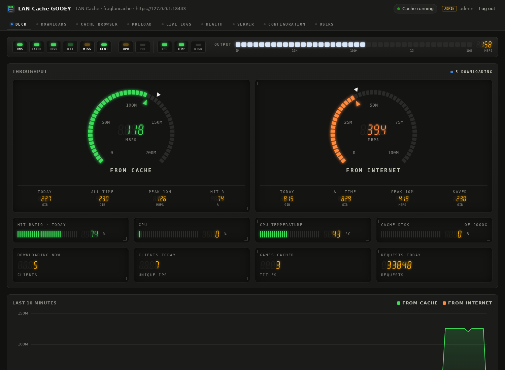
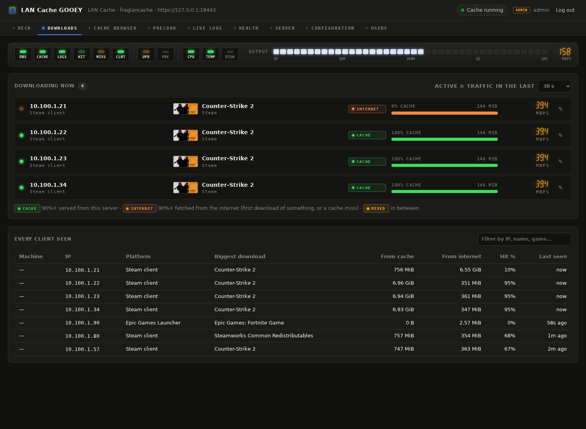
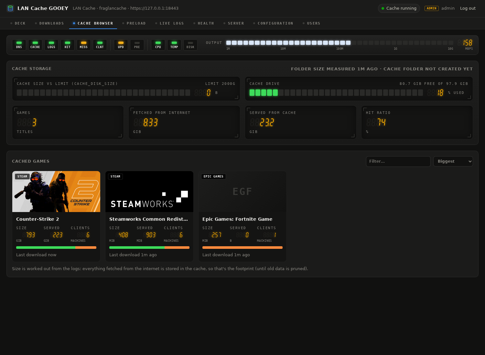
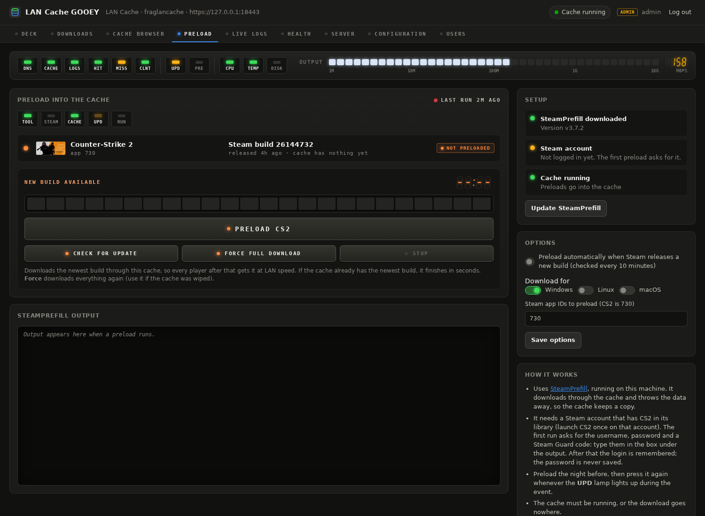

# LAN-cache-GOOEY

A web control panel (a GUI, "gooey") for a [lancache.net](https://lancache.net) game download cache, built for LAN
parties and tournaments. Watch who is downloading and whether it comes from the cache or the internet, browse
what's cached, follow the logs live, edit the settings for each venue, start and stop the cache, and **preload
Counter-Strike 2 with one button** when Valve ships an update mid-event.

It's plain Python 3 (standard library only), with no build step and nothing loaded from the internet, so it works on
an offline LAN. The look comes from [Perf-Deck](https://github.com/turkey415/Perf-Deck).



<sub>Screenshots use simulated traffic.</sub>

## Install

On a Linux machine (tested on Ubuntu 26.04), next to the official lancache docker-compose files:

```bash
git clone https://github.com/lancachenet/docker-compose lancache
cd lancache
git clone https://github.com/turkey415/LAN-cache-GOOEY webgui
sudo ./webgui/install.sh
```

`install.sh` installs Docker and the compose plugin (Ubuntu packages) if they're missing, lets your user run Docker,
makes the cache logs readable, and installs the `lancache-gui` service so the panel starts at boot.
Then open **https://&lt;this machine's IP&gt;:8443/**. The certificate is self-signed, so the browser warns once.

The first admin password is printed at the end of the install and saved in `webgui/data/INITIAL_ADMIN_PASSWORD.txt`.
Change it under **Users**, which also deletes the file. Forgot it? `cd webgui && python3 server.py --reset-password admin`

You don't need to edit anything by hand first: set the IPs and disk in **Configuration**, then press **Start** on
the **Service** tab.

## Tabs

| Tab | What it's for |
|---|---|
| **Deck** | Throughput dials (from cache vs from internet), hit ratio, CPU, temperature, cache disk, a 10-minute chart, and who is downloading. |
| **Downloads** | Every machine downloading right now: game (with cover art), platform (Steam, Epic, Battle.net…), speed, and a **CACHE** / **INTERNET** / **MIXED** badge. Name machines ("Seat 12") with ✎. Below that is every client ever seen; click one for its per-game history. |
| **Cache Browser** | Every cached game with cover art, size in the cache, data served, and machine count. Click a game for its download history per machine. |
| **Preload** | Download CS2 (or any Steam games) into the cache before players do. See below. |
| **Live Logs** | Streaming access log (hits green, misses orange), nginx errors, the cache and DNS container logs, and the GUI's own log. Filter, pause, hits/misses only. |
| **Health** | CPU load per core, clock, temperatures (CPU, NVMe, GPU), memory, load, drives, network throughput and link use, container stats. |
| **Service** | Start / Stop / Restart / Update the containers with live output, a pre-flight checklist, a DNS test, and a start-on-boot switch. |
| **Configuration** | Edit `.env` as a form (each setting's help text and live checks) or as raw text, plus `docker-compose.yml`. "This machine" fills in the current IP. Every save makes a backup you can view or restore. Save **venue profiles**. |
| **Users** | Admin and viewer accounts, the activity log, and changing your own password. |

**Roles:** `admin` can change everything; `viewer` sees every tab but can't change settings or start/stop anything.




## Preloading CS2



The **Preload** tab drives [SteamPrefill](https://github.com/tpill90/steam-lancache-prefill), which runs on the
cache machine, downloads the game through the cache and throws the data away, so the cache keeps a copy and every
player after that gets it at LAN speed.

1. **Download SteamPrefill** (one button; needs internet once).
2. Press **Preload CS2**. The first time, SteamPrefill asks for a Steam username, password and Steam Guard code.
   Type them into the box under the output. Use an account that has CS2 in its library. SteamPrefill remembers the
   login; the password is never saved.
3. The panel checks Steam for a new CS2 build every 10 minutes. When there is one, the **UPD** lamp blinks on every
   tab: press **Preload CS2** again. It only downloads what changed, and finishes in seconds when the cache is
   already up to date. Or switch on **Preload automatically**.

**Force full download** fetches everything again (for a wiped cache). Other Steam games: add their app IDs under Options.

## Storage

**Configuration → Storage** lists every disk with its status (system, in cache, mounted, has data, empty).

- **Spare disks:** tick them and apply. They're combined end to end (LVM, JBOD-style) into one volume mounted at
  `/srv/lancache`, with game data in `/srv/lancache/cache` and logs in `/srv/lancache/logs`. Add more disks
  later to grow it without losing cached games. If one disk dies the cache volume is lost, which for a cache just
  means re-downloading.
- **The system disk** is never repartitioned. Ubuntu's installer often uses only 100 GB of a big disk and leaves
  the rest unused in its LVM pool. **▼ Use free space for the cache** makes a cache volume from that unused space,
  **▲ Grow cache volume** adds more mid-event, and **▲ Grow system volume** gives `/` more room. All of these work
  while the machine is running. 20 GiB of the pool is always kept back.
- Every change shows the exact commands and asks you to type a name to confirm. Disk changes run through a small
  root-owned helper (`tools/lancache-gooey-disk`) that `install.sh` installs with a sudo rule for only that program.
  It re-checks every request and refuses the system disk, mounted disks, and disks belonging to other volumes.

Why not RAID? The network is the bottleneck: 1 Gb/s is about 125 MB/s, and even 10 Gb/s is about 1.25 GB/s.
One NVMe drive is far faster than that, and hot data is served from RAM. Striping would also stop you from adding
one disk at a time, and mirroring wastes half the space protecting data you can re-download.

## Moving to a new venue

1. Plug in and boot. The panel listens on whatever address DHCP gives the machine.
2. **Configuration → This machine**: click the current address. It fills `LANCACHE_IP` and `DNS_BIND_IP`.
   Or load a saved **venue profile**.
3. **Save and restart cache**.
4. **Service → DNS test** should show game names pointing at the cache.
5. Point the venue's DHCP DNS server option at `DNS_BIND_IP` (or set players' DNS by hand).
6. Optional: **Configuration → New HTTPS certificate** so the certificate matches the new IP, then
   `sudo systemctl restart lancache-gui`.

## How downloads are identified

The cache container logs every request with its client IP, service (`[steam]`, `[epicgames]`…) and cache result
(`HIT` = served from the cache, `MISS` = fetched from the internet). The panel follows that log and keeps history
in `webgui/data/stats.sqlite3`. Steam requests carry a *depot* number, which is mapped to a game. CS2's depots are
built in; other games are looked up through the Steam API (needs internet), and an admin can map a depot by hand in
the Cache Browser. "Size in cache" is the data fetched from the internet, which is what the cache stored (until it
prunes old data).

## Files

- `server.py`: HTTPS server and API. `lcgui/`: config editing, Docker control, log reading, stats, health, preload.
- `static/`: the page (`index.html`, `app.js`, `style.css`).
- `install.sh`: one-time setup (Docker, permissions, systemd service).
- `data/` (created at runtime, not in git): users, sessions, TLS certificate, stats database, backups, venue
  profiles, cover art cache, SteamPrefill and its Steam login.

Environment variables: `LCGUI_PORT` (default 8443), `LCGUI_BIND` (default all addresses), `LCGUI_DATA`,
`LANCACHE_DIR` (default: the folder above `webgui`).

## Credits

- [lancache.net](https://lancache.net) for the cache itself.
- [SteamPrefill](https://github.com/tpill90/steam-lancache-prefill) by Tim Pilius (MIT), downloaded at runtime for preloading.
- Instruments and styling from [Perf-Deck](https://github.com/turkey415/Perf-Deck) (MIT).
- Game cover art is fetched from Steam's CDN and belongs to its owners.

## License

MIT. See [LICENSE](LICENSE).
